# Duelborne

**A card-duel game you play in the browser — against the computer or with friends on your local network.**
Duelborne runs a real rules engine (ocgcore) on a small Node server; every phone, tablet or PC on the same
network just opens a web page to play. French and English, mouse, touch and keyboard.

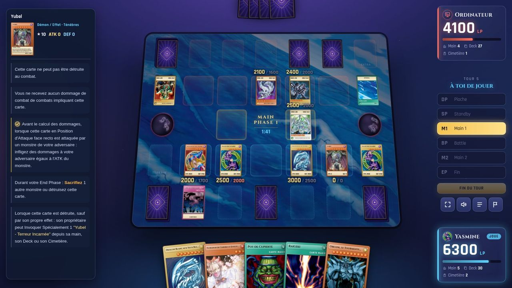

## What you can do

### Play solo

Duel the computer at three difficulty levels, watch two AIs fight, run a tournament against computer players,
or experiment freely in the sandbox.

| Solo menu | Room against the computer |
| --- | --- |
| 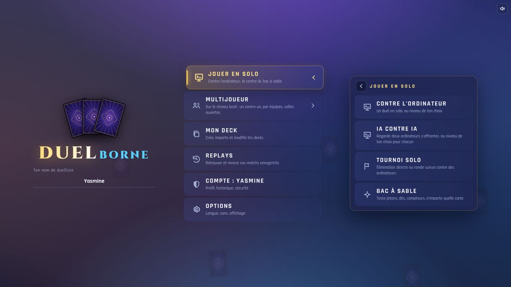 | 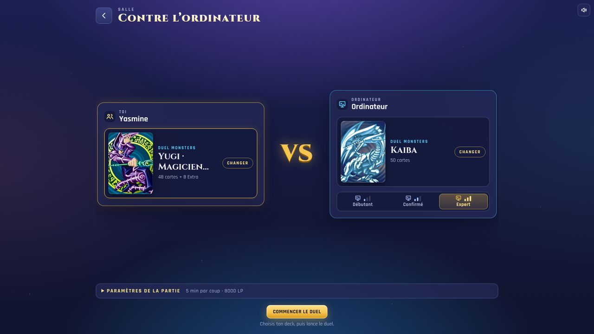 |
| **Coin toss before the duel** | **Your turn: actions appear right on the card** |
| 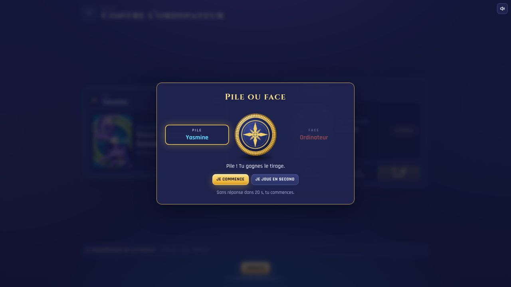 | 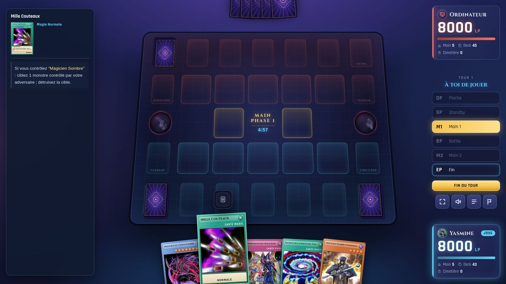 |

### Play with friends on your network

One computer runs the server; everyone else opens its address in a browser. One-on-one or two-against-two,
open rooms, spectators — no internet connection needed during play.

| Multiplayer menu | Two-against-two room |
| --- | --- |
| 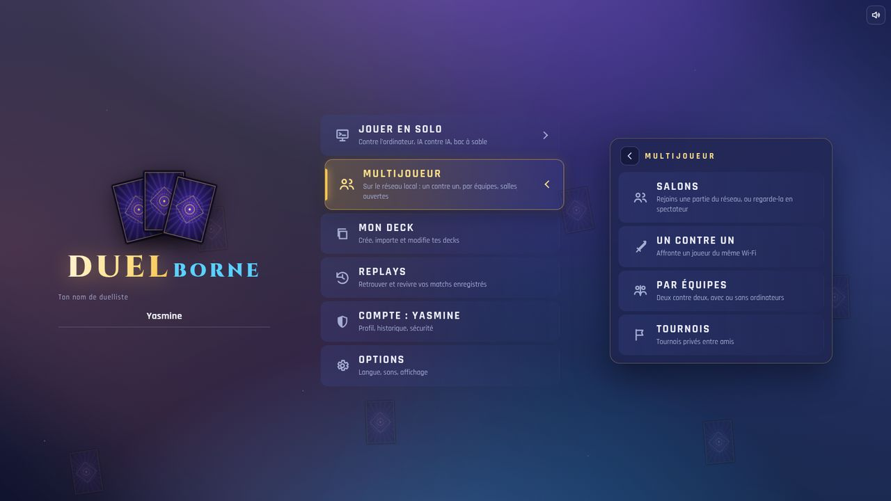 | 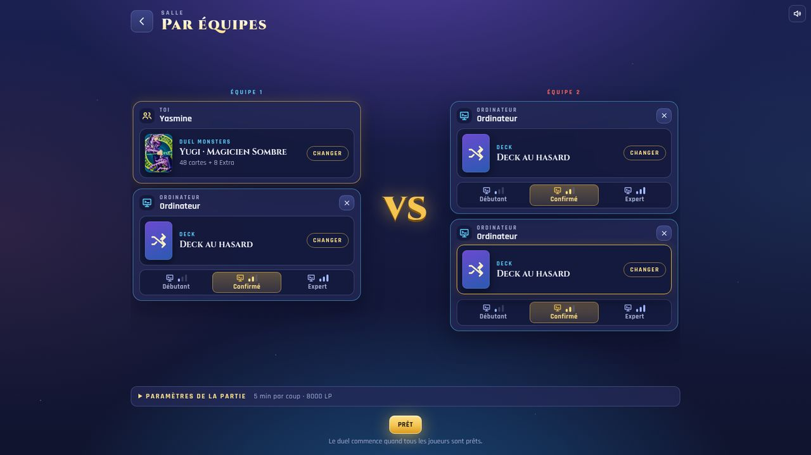 |

| Team duel: the teammate who has the lead is highlighted |
| --- |
| 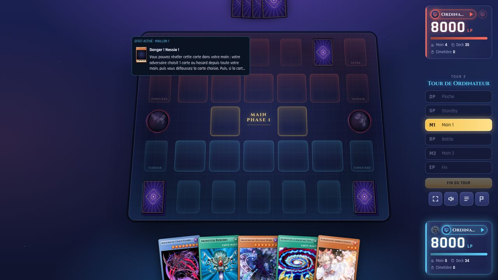 |

### Watch, review and learn

| AI against AI | Duel journal |
| --- | --- |
| 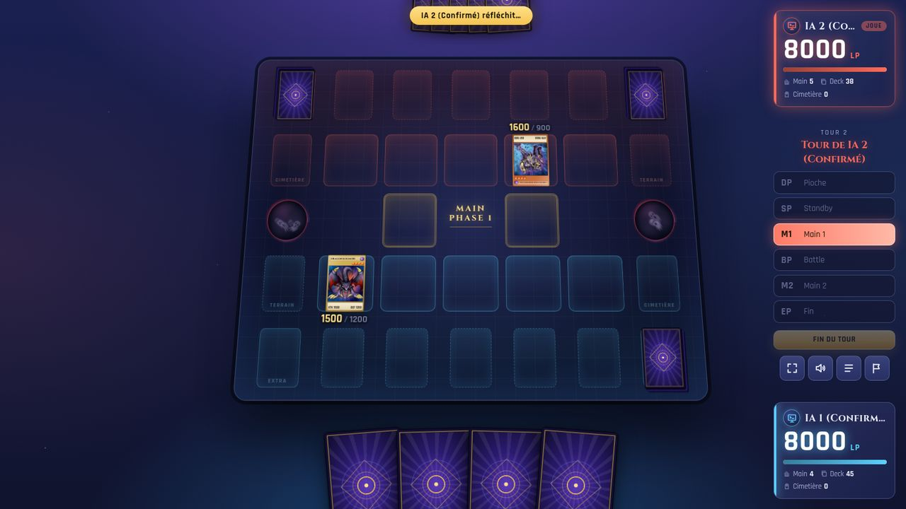 | 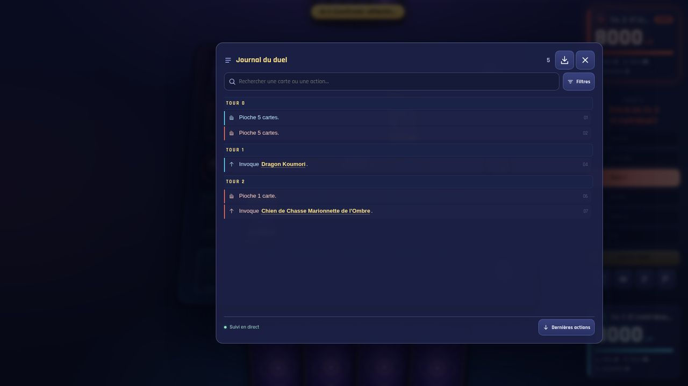 |
| **Replay library** | **Replay player with timeline** |
| 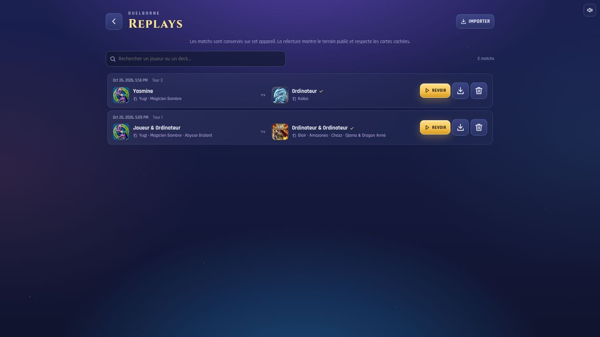 | 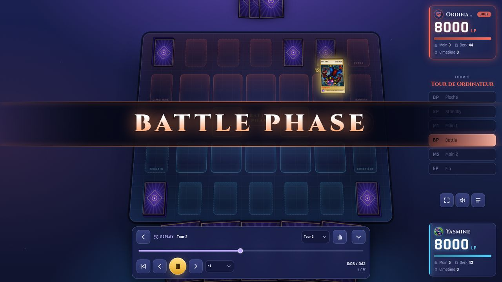 |

### Tournaments

Single elimination or Swiss rounds, solo against computer players or private between friends,
with a live bracket and spectating.

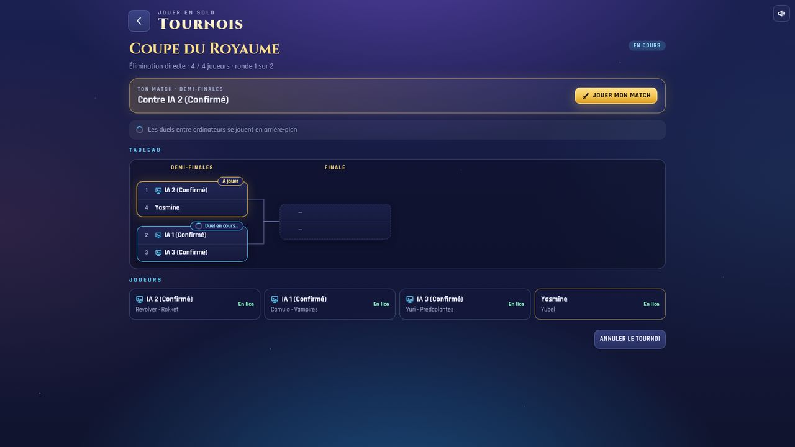

### Build your decks

Search every card in French or English, filter by type, attribute or level, import and export `.ydk` files,
start from 100 ready-made decks, and check a deck against a format (TCG, OCG, GOAT, Genesys).

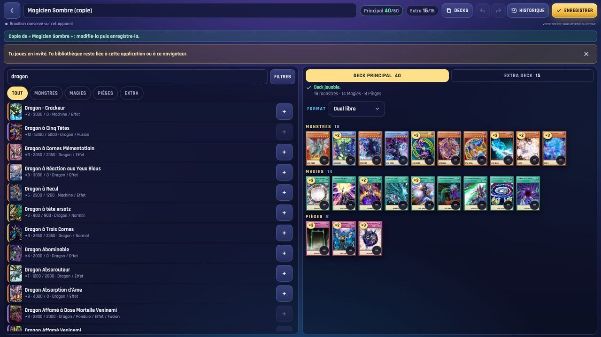

### Sandbox and profile

| Sandbox console: add any card, tokens, dice, counters, LP… | Choose an avatar from any card artwork |
| --- | --- |
| 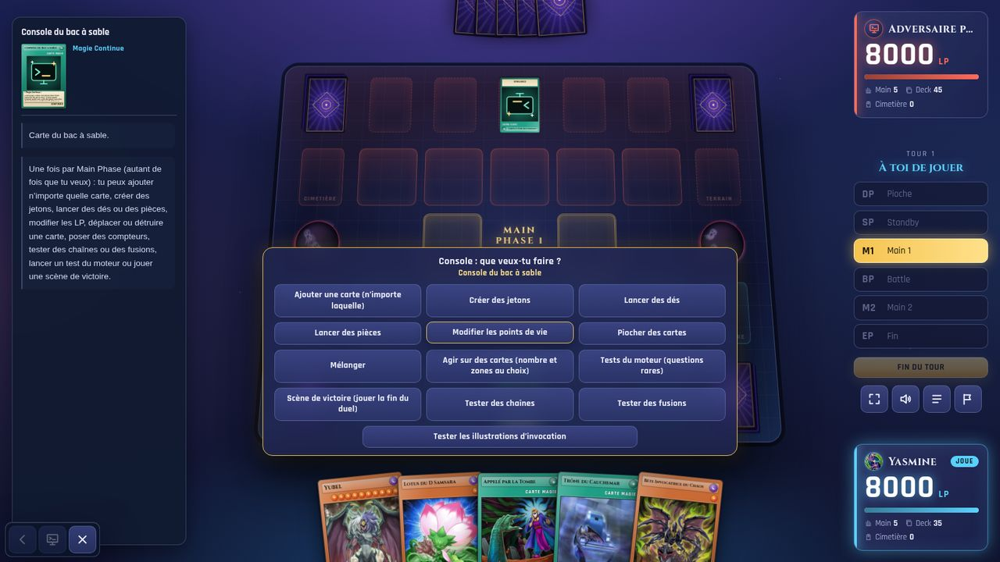 | 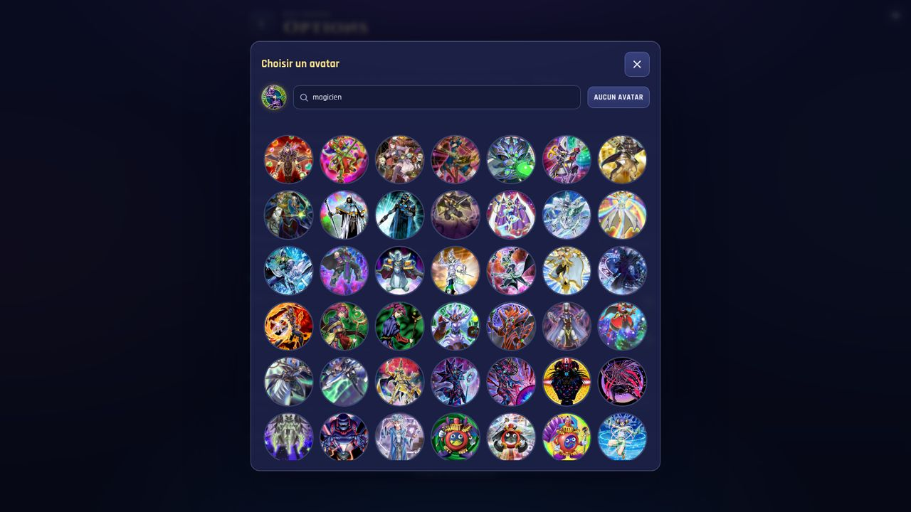 |

### On a phone

The board always fits the screen, from a phone in landscape to a large monitor. Install it as an app (PWA).

| Home | Duel |
| --- | --- |
| 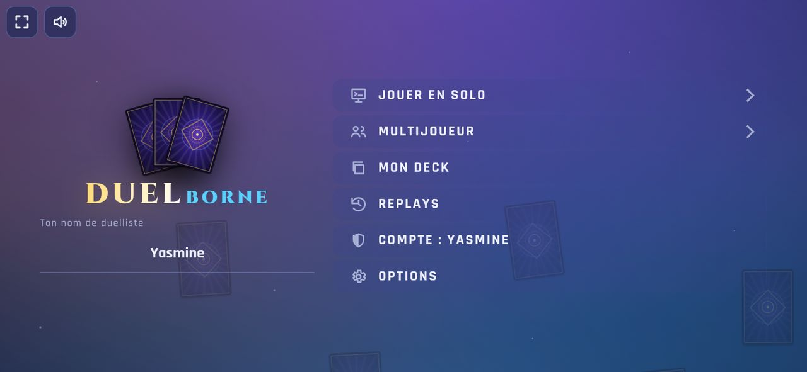 | 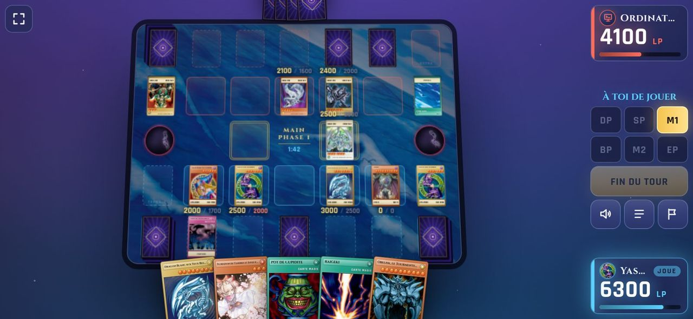 |

Optional **accounts** keep decks, preferences, avatar and match history across devices; guests can play everything.

## Installation

### Requirements

- [Node.js](https://nodejs.org/) **22.18 or newer** (the server uses the built-in `node:sqlite`)
- [Git](https://git-scm.com/) (used to download the card scripts)
- About **3 GB** of free disk space for card data and images
- Optional: [ImageMagick](https://imagemagick.org/) to rebuild missing artworks

### 1. Get the code

```sh
git clone https://github.com/djantche/duelborne.git
cd duelborne
npm install
```

### 2. Download the game data

Cards, images, effect scripts and sounds are **not** part of this repository (they belong to third parties).
One command fetches them into `data/`:

```sh
npm run restore-data
```

It runs, in order: card list and images (`fetch-cards`), French texts (`fetch-fr`, `fetch-fr-cdb`, `fill-fr`),
the rules engine scripts (`fetch-ocg`) and the sound pack (`fetch-sounds`). The first run takes a while;
running it again only downloads what is missing.

### 3. Play

```sh
npm run dev
```

Open **http://localhost:3000**. The server also prints the address other devices on your network should open
(for example `http://192.168.1.20:3000`). Allow Node through your firewall on private networks.

For a faster, production build:

```sh
npm run build
npm start
```

### Configuration

| Variable | Default | Purpose |
| --- | --- | --- |
| `PORT` | `3000` | port of the web server |
| `DUEL_SAVE_DIR` | `save/` | where accounts, decks and history are stored (SQLite) |
| `DUEL_NO_SYNC` | — | set to `1` to stop the weekly refresh of format lists |

Example: `PORT=8080 npm start`.

### Useful commands

| Command | What it does |
| --- | --- |
| `npm run restore-data` | download or complete the game data |
| `npm run sync-lists` | refresh the format ban lists |
| `npm run db:backup` / `db:list` / `db:restore` | back up and restore the player database |
| `npm run typecheck` | check the TypeScript code |

## Project layout

```
src/shared/   protocol and formats shared by server and client
src/server/   web server, rooms, rules engine, AI, accounts, tournaments, replays
src/client/   Preact web app (screens, UI components, styles, translations)
vendor/       ocgcore WebAssembly wrapper
scripts/      data download and deck generation
tools/        developer tools (database, format lists, visual checks)
```

Contributions are welcome: open an issue to discuss an idea, then a pull request.
New interface text needs a key in both `src/client/locales/fr.json` and `en.json`.

## Credits

- Rules engine: [ygopro-core](https://github.com/edo9300/ygopro-core) (AGPL-3.0), compiled to WebAssembly by
  [ocgcore-wasm](https://github.com/n1xx1/ocgcore-wasm) (MIT) — see `vendor/ocgcore/README.md`.
- Card scripts, card database and engine strings: [Project Ignis](https://github.com/ProjectIgnis) (AGPL-3.0).
- Card list and images: [YGOPRODeck](https://ygoprodeck.com/api-guide/). French texts: Project Ignis and
  [Yugipedia](https://yugipedia.com/).
- Sounds: [EDOPRO-Soundpack](https://github.com/Lahrenheit/EDOPRO-Soundpack) by Lahrenheit.
- Fonts: Cinzel and Rajdhani (SIL Open Font License).

## Legal

Duelborne is a free, non-commercial fan project. It is **not affiliated with, endorsed or sponsored by Konami**.
Card names, texts and artwork are the property of their respective owners; no card data, artwork or music is
distributed in this repository — each player downloads them for personal use. Screenshots show the game running
with that downloaded data.

The Duelborne source code is released under the [GNU AGPL-3.0](LICENSE) (or any later version).
If you host a modified version for others to play, you must share your changes.

---

### En français

Duelborne est un jeu de duel de cartes qui se joue dans le navigateur, contre l'ordinateur ou entre amis sur le
réseau local : duel contre l'ordinateur (trois niveaux), IA contre IA, un contre un et deux contre deux, tournois,
éditeur de deck, replays, bac à sable et comptes facultatifs. Installation : `npm install`, puis
`npm run restore-data` (télécharge cartes, images, scripts et sons dans `data/`), puis `npm run dev` et ouvrir
http://localhost:3000. L'interface est en français et en anglais.
